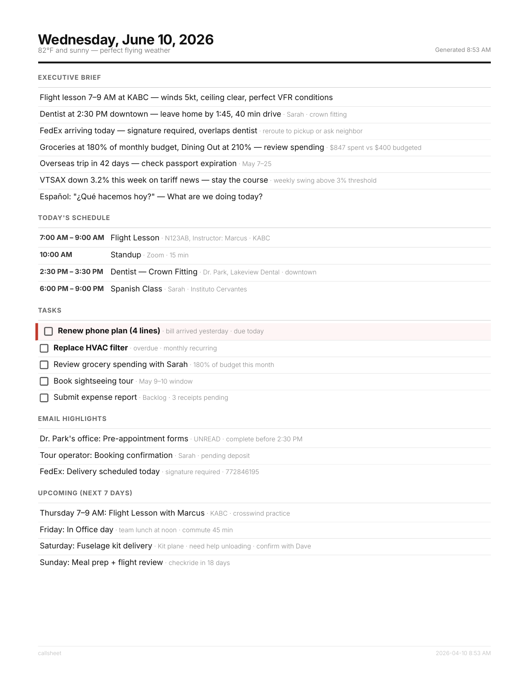

[](https://codecov.io/gh/gemivnet/callsheet)


# Callsheet

**Your household's daily brief — fetched, prioritized, and printed by AI.**

In the film industry, a *call sheet* is the single page that tells everyone on set where to be, what's happening, and what to prepare for. This is that, but for your home.

Think of it as a Presidential Daily Brief for home life. Callsheet pulls data from your calendar, tasks, email, weather, budget, and other sources — feeds it all to Claude — and Claude decides what actually matters today. The result is a single printed page on the counter every morning. Not everything that's happening. Just what you need to know.

It's opinionated by design. Claude acts as an analyst, not a formatter — connecting dots across sources ("your flight lesson is at 9 AM but the ceiling drops to 1200 by then"), filtering noise (routine emails, unremarkable weather), and surfacing what needs action now. Quiet days get short briefs. Busy days get dense ones.

Built for ADHD households, busy couples, and anyone who's tired of context-switching between twelve apps before coffee.

<p align="center">
  
</p>

---

## How it works

```
cron (6:30 AM) or web dashboard trigger
  → callsheet
    → connectors fetch data (calendar, tasks, email, weather, ...)
    → Claude reads everything, decides what matters
    → outputs structured JSON brief
    → @react-pdf/renderer renders to PDF
    → CUPS sends to your printer (or view in dashboard)
```

**Claude is the analyst.** It doesn't format your data into a template — it makes judgment calls. Flight lesson on the calendar + TAF showing ceiling dropping to 1200 at lesson time = *"Ceiling forecast MVFR at 9 AM — confirm with your CFI."* Billing email from your phone carrier yesterday + no renewal task = *"Renew phone plan today before auto-suspend."* Fourteen items building up in someone's inbox = *"Process inbox tonight?"* Unremarkable weather on a day with no outdoor plans? Not mentioned.

## What the brief looks like

A single-page PDF — every item earns its spot:

- **Executive Brief** — up to four cross-referenced insights: conflicts, logistics, deadlines, weather that changes a plan, spending anomalies
- **Today's Focus** *(task coach)* — a few tasks per person worth doing *today*, each with a time slot from that person's free time, and how yesterday's picks went
- **Today's schedule** — calendar events, attributed to the person they're for, with spans and computed conflicts
- **Tasks** — the time-sensitive rest: chores tied to today, bills and forms coming due. Checkboxes you mark with a pen
- **Stuck — Decide Today** *(task coach)* — tasks that haven't moved in weeks, each with one recommendation: schedule, first step, hand off, or drop
- **Email highlights** — only emails with news you need, never "reply to" a thread you already answered
- **Upcoming** — things this week that need preparation, collapsed where repetitive
- **Added to Todoist** / **Capture** *(task coach)* — what callsheet added to your Todoist from email and the calendar, and a prompt or two to jog memory for tasks nobody wrote down

Sections adapt to the day. Quiet Tuesday? Half-page brief. Packed Thursday before a trip? Dense and focused. Claude doesn't manufacture importance to fill space.

**Memory across days:** After each brief, open loops (deliveries, due dates, appointments mentioned only in email) are saved with the date they stop mattering, so the next days can follow them after the email ages out.

**Brief diff:** Yesterday's brief is summarized as context so Claude highlights what's new or changed.

**Review before printing:** Executive Brief items that merely restate another section are removed in code, and a fact check compares the brief with the data — a correction is applied only when it quotes both the wrong words and the data that contradicts them, and both quotes check out.

## Task coach

Turn it on with `task_coach: { enabled: true }`. Alongside the brief, Claude returns a plan — focus picks, decisions for stuck tasks, and actions found in email or the calendar that aren't tasks yet. Callsheet checks the plan against your real Todoist data, then:

- adds the captured actions to the right person's Todoist inbox under a label (`callsheet` by default), with any due date the source stated — de-duplicated against open tasks, and never re-added once made, even if you delete it;
- sets undated, non-recurring focus picks to due today, so they show on your phone;
- prints the plan, plus yesterday's score.

It never deletes, closes or rewrites a task, and writes nothing on a dashboard preview. Stuck tasks (long overdue, rescheduled again and again, sitting in an inbox for weeks) are asked about once, then left alone for a week. See [the setup guide](docs/SETUP_GUIDE.md#task-coach) for the options.

## Context that keeps itself current

The household context you write in config goes stale — plans end, jobs change. Context entries can carry an `until` date, prose whose dates have all passed is marked as history, and with `living_context` turned on callsheet learns changes from the data itself: each one backed by a quote from an email, event or task, printed under Housekeeping the day it is learned, and expiring on its own. Config is never edited; entries the data contradicts are listed for you to update.

## Reliability

A printed brief that silently stops is worse than none, so a run is only "done" when the page has come out of the printer:

- **Printing** retries, then watches the CUPS job until it completes. A job that can't be submitted, or sits in the queue, sends an alert to `notify_webhook`.
- **Missed runs are caught up.** If the host was paused or the container was down at the scheduled time, the brief is produced late (within `CATCHUP_HOURS`, default 6) instead of skipping the day.
- **Every run is recorded** in `output/status.json`. `GET /api/status` returns `503` when the last scheduled brief failed to generate or print, or a due run never happened — point an uptime monitor at it. `GET /api/health` stays a pure liveness check.
- **Repeat failures alert.** A connector that fails two scheduled mornings running sends one warning; an optional `heartbeat_url` (e.g. healthchecks.io) is pinged after every good run, as a dead-man's switch.
- **Stale data is named, not trusted.** Sources report how fresh their data is (a stopped bank import, an alerts outage, a truncated inbox), and the brief says so instead of reporting "$0 spent" or "no alerts".

## Getting started

See the **[Getting Started Guide](docs/SETUP_GUIDE.md)** for full setup instructions covering all deployment methods, connector configuration, and troubleshooting.

## Connectors

Connectors are pluggable data sources. Enable them in `config.yaml`, test with `--test`.

| Connector | What it does | Auth |
|-----------|-------------|------|
| `google_calendar` | Today's events + 7-day lookahead | Google OAuth |
| `todoist` | Tasks, inbox, upcoming (multi-account) | API token |
| `gmail` | Scans recent emails for actionable signals | Google OAuth |
| `weather` | Today's forecast via NWS | None (free) |
| `aviation_weather` | METAR/TAF for nearby airports | None (free) |
| `home_assistant` | Smart home sensor states + anomalies | HA token |
| `market` | Stock/fund daily snapshot + news | None (free) |
| `actual_budget` | Recent transactions, spending, budget alerts | Server password |
| `garbage_recycling` | Pickup-day reminders from configured schedules | None (config-driven) |
| `sun_moon` | Sunrise/sunset, twilight, moon phase | None (local computation) |
| `language` | Phrase-of-the-day with anti-repeat history | None |

### Writing your own

Create a file in `src/connectors/`, export a `create` factory function, and register it in `src/connectors/index.ts`. See [docs/CONNECTORS.md](docs/CONNECTORS.md).

## Customization

### Three things you tune

| File | What it does |
|------|-------------|
| `config.yaml` | Which connectors are on, accounts, API settings |
| `src/prompts/system.md` | Claude's instructions — sections, tone, what to flag |
| `config.yaml > context:` | Household info so Claude makes smarter connections |

### Household

`household:` lists everyone the brief is about — including anyone without a
calendar, inbox or task list of their own, who would otherwise be invisible to
it:

```yaml
household:
  - name: Person 1
    role: self
  - name: Person 2
    role: partner
  - name: Person 3
    role: guest
    notes: Staying with us this year; no accounts of their own.
```

`context:` is free-form background, injected into Claude's prompt alongside it:

```yaml
context:
  work: "Person 1 is a nurse, 3x12hr shifts. Person 2 is remote."
  health: "Person 2 has ADHD — keep it scannable, flag inbox buildup"
  hobbies: "Both learning pottery. Person 1 runs marathons."
  bills: "Phone plan bills monthly, needs manual renewal next day"
  travel: "Family trip abroad, June 1-14. Flag packing under 7 days."
  deadlines: "Person 2's thesis due April 30."
```

### The prompt

`src/prompts/system.md` controls what Claude generates. Want a word-of-the-day? Add a section. Want Claude to ignore market data unless it drops 5%? Change the threshold.

### The PDF layout

`src/render.tsx` controls the visual design using React components and `@react-pdf/renderer`. Modify the `StyleSheet.create()` styles to change fonts, spacing, colors, or page size.

## Architecture

```
callsheet/
├── src/
│   ├── cli.ts                     # CLI entry point
│   ├── core.ts                    # Orchestrator: fetch → Claude → review → PDF → print
│   ├── tasks.ts                   # Task coach: focus, stuck tasks, captures, Todoist writes
│   ├── review.ts                  # Pre-print review: dedupe + evidence-bound fact check
│   ├── autoclose.ts               # Close Todoist tasks that email/transactions prove done
│   ├── context.ts                 # Household context with expiry and staleness checks
│   ├── living.ts                  # Living context: household changes learned from the data
│   ├── print.ts                   # CUPS printing with retry and job confirmation
│   ├── status.ts                  # Run status, failure streaks, health evaluation
│   ├── llm.ts                     # Shared helpers for model responses
│   ├── server.ts                  # Express API server
│   ├── scheduler.ts               # node-cron wrapper with catch-up for Docker modes
│   ├── entrypoint.ts              # Docker MODE dispatcher
│   ├── usage.ts                   # API cost tracking
│   ├── render.tsx                 # React PDF components + styling
│   ├── test-connectors.ts        # Connector test runner
│   ├── types.ts                   # Shared TypeScript interfaces
│   ├── connectors/
│   │   ├── index.ts               # Registry + loader
│   │   ├── google-auth.ts
│   │   ├── google-calendar.ts
│   │   ├── todoist.ts
│   │   ├── gmail.ts
│   │   ├── weather.ts
│   │   ├── aviation-weather.ts
│   │   ├── market.ts
│   │   ├── home-assistant.ts
│   │   ├── actual-budget.ts
│   │   ├── garbage-recycling.ts
│   │   ├── sun-moon.ts
│   │   ├── homelab.ts
│   │   └── language.ts
│   └── prompts/
│       └── system.md              # Claude's instructions (tune this!)
├── web/
│   ├── build.mjs                  # esbuild bundler
│   ├── public/index.html
│   └── src/
│       ├── App.tsx                # SPA shell with sidebar nav
│       ├── pages/                 # Dashboard, Briefs, Connectors, etc.
│       └── styles.css
├── test/                           # Jest tests (mirrors src/)
├── docs/
│   ├── CONNECTORS.md              # How to write connectors
│   ├── RELEASING.md               # Release pipeline + versioning
│   └── SETUP_GUIDE.md             # Full getting started guide
├── docker-compose.yml             # Headless mode (cron only)
├── docker-compose.headed.yml      # Override: adds dashboard on port 3000
├── Dockerfile
├── config.example.yaml
├── package.json
├── tsconfig.json
├── .env.example
├── .gitignore
└── README.md
```

## Cost

Each brief makes one call on your configured model, plus small housekeeping
calls (memory, fact check, auto-close) on Claude Haiku 5.5 that together cost a
fraction of a cent. A two-account household running most connectors sends
roughly 60K input tokens to the brief model.

| Brief model | Per brief | Per month |
|-------------|-----------|-----------|
| Sonnet 5.5 (default) | ~$0.25 | ~$7.50 |
| Opus 5.5 | ~$0.50 | ~$15 |

Connector data volume is the main lever — the **Usage** page in the dashboard
shows your actual numbers.

## Why this exists

### Why print?

A physical page on the counter gets looked at. An app in a notification drawer doesn't. For ADHD, the brief is ambient, visible, and requires zero activation energy — it's just *there*.

### Why AI, not a template?

A template gives you a formatted list of your data — a dashboard. Claude gives you *"Your flight lesson is at 9 but the TAF shows ceiling dropping to 1200 by then — call your CFI."* The difference is judgment. A template shows you everything. An analyst shows you what matters. Callsheet is an analyst.

### Why connectors, not just APIs?

Every household is different. The connector pattern means you write a TypeScript file, export a factory, register it, and it works. But this isn't meant to be a catch-all — more connectors doesn't mean a better brief. Add sources that give Claude meaningful signal. Skip sources that add noise.

### Can I use this without a printer?

Yes. `--preview` saves the PDF. Email it, display it on a tablet, show it on a dashboard — whatever works.

## Contributing

PRs welcome — especially new connectors. See [docs/CONNECTORS.md](docs/CONNECTORS.md).

Some ideas: Slack, GitHub, Fitbit, Anki, Radarr/Sonarr, Notion, CalDAV, Withings, Oura Ring, air quality.

## License

[AGPL-3.0](LICENSE) — free to use, modify, and distribute, but derivative works (including network use) must remain open source.
